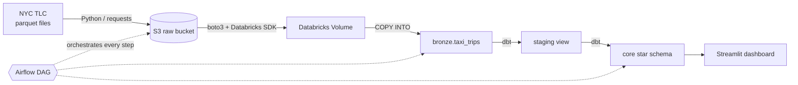
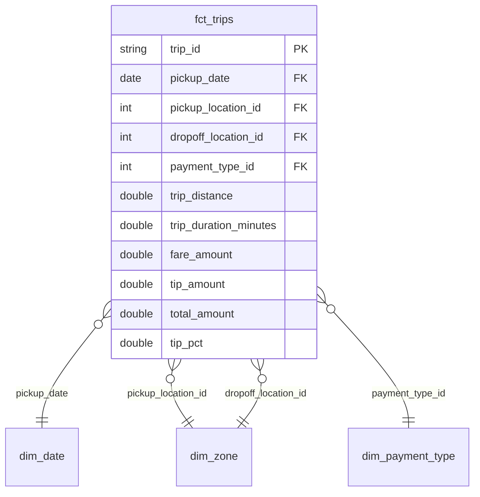

# NYC Taxi Data Pipeline

An end-to-end batch data pipeline: public NYC Yellow Taxi data is ingested into S3, loaded into Databricks, modeled into a tested star schema with dbt, orchestrated by Airflow, and served through a dashboard.

## Architecture



| Layer | Tool |
|---|---|
| Ingestion | Python (`requests`, `boto3`) |
| Raw storage | AWS S3 |
| Warehouse / compute | Databricks (SQL warehouse, Delta tables) |
| Transformation and testing | dbt (`dbt-databricks`) |
| Orchestration | Apache Airflow (Astro CLI, Docker) |
| Dashboard | Streamlit |

## Data model

**Grain:** one row per cleaned taxi trip.



| Model | Layer | Purpose |
|---|---|---|
| `stg_taxi_trips` | staging | Rename, filter bad records, build `trip_id`, deduplicate |
| `fct_trips` | core | Fact table of trips with measures |
| `dim_zone` | core | Borough and zone names (from the TLC lookup seed) |
| `dim_date` | core | Calendar attributes, weekend flag |
| `dim_payment_type` | core | Payment code descriptions |
| `fct_daily_revenue` | mart | Daily trips and revenue for the dashboard |
| `fct_revenue_by_zone` | mart | Revenue by pickup zone |

## dbt lineage


## Dashboard


## Repository layout

```
ingestion/        standalone ingestion script (web -> S3)
taxi_dbt/         dbt project (staging, core, marts, seeds, tests)
airflow/          Astro project: DAG in dags/, pipeline code in include/
dashboard.py      Streamlit app reading the gold tables
docs/             screenshots
```

## How to run

**Prerequisites:** Python 3.12, Docker Desktop, Astro CLI, an AWS account with an S3 bucket, and a Databricks workspace (Free Edition works).

1. **Configure credentials.** Copy `.env.example` to `.env` and fill in your values. Never commit `.env`.

2. **One-time Databricks setup** (SQL editor):

```sql
CREATE SCHEMA IF NOT EXISTS workspace.bronze;
CREATE VOLUME IF NOT EXISTS workspace.bronze.raw;
CREATE TABLE IF NOT EXISTS workspace.bronze.taxi_trips
TBLPROPERTIES ('delta.feature.timestampNtz' = 'supported');
```

3. **Build the models locally:**

```bash
python3.12 -m venv .venv && source .venv/bin/activate
pip install dbt-databricks databricks-sql-connector streamlit boto3 requests
set -a; source .env; set +a
cd taxi_dbt && dbt build
```

4. **Run the pipeline in Airflow.** Create `airflow/.env` containing the same variables plus `AWS_ACCESS_KEY_ID`, `AWS_SECRET_ACCESS_KEY`, `AWS_DEFAULT_REGION`, and `DBT_PROFILES_DIR=/usr/local/airflow/include/taxi_dbt`. Then:

```bash
cd airflow
astro dev start
```

Open http://localhost:8080 and trigger `nyc_taxi_pipeline` (the `month` parameter defaults to `2024-04`).

5. **Start the dashboard:**

```bash
streamlit run dashboard.py
```

## Design decisions

- **Idempotent loads.** `COPY INTO` tracks the files it has loaded, so re-running a month adds no duplicate rows.
- **Deduplication.** The source has no trip ID, so staging builds one by hashing trip attributes and keeps one row per hash.
- **Raw data stays in S3.** S3 is the system of record for raw files. Databricks Free Edition cannot read directly from a custom S3 location, so the DAG copies each month into a Unity Catalog Volume. On a paid workspace this hop would be replaced by an external location.
- **dbt runs in its own virtualenv inside the Airflow image,** which avoids dependency conflicts with Airflow's packages.
- **Secrets** are read from environment variables and never committed. `profiles.yml` contains only `env_var()` references.
- The dbt project is copied into `airflow/include/` so the container can run it.

## Data quality

dbt tests cover not-null and unique keys on every dimension and on `fct_trips.trip_id`, plus referential integrity from each foreign key in `fct_trips` to its dimension. A failing test stops the DAG.

## Limitations and roadmap

- [x] S3 ingestion, bronze load, dbt star schema, Airflow DAG, dashboard
- [ ] Incremental `fct_trips` (merge on `trip_id`)
- [ ] Monthly schedule that derives the month from the run date
- [ ] Second source via Fivetran, joined into the core layer
- Data covers January to April 2024 only.
